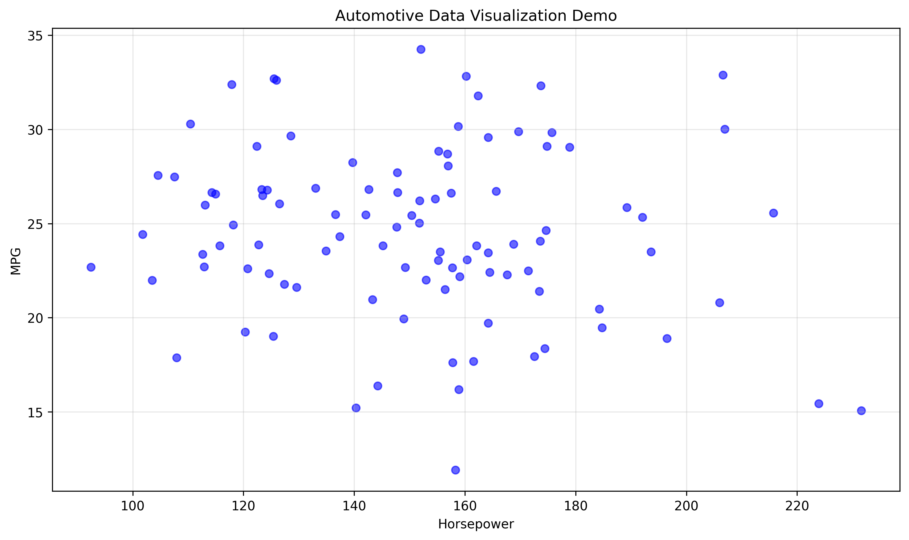

# Vehicle Emissions & Fuel Efficiency: Data Pipeline and Analytics Dashboard

Course project for Foundations of Data Science at VIT Vellore (Prof. Kumar K). It builds a data pipeline for vehicle fuel-economy and emissions data: loading, quality checks, cleaning and feature engineering. The results are shown in an interactive Plotly Dash dashboard.



## Data

| Dataset | Rows | Source |
|---|---:|---|
| UCI Auto MPG | 398 | real, downloaded from the UCI repository |
| EPA-style fuel economy | 1,000 | synthetic, generated in `download_datasets.py` with a fixed seed |
| Vehicle listings | 2,000 | synthetic, generated in `download_datasets.py` with a fixed seed |

The two synthetic sets follow the schemas of the public EPA and Kaggle datasets. They let the pipeline be tested on larger, messier tables. They are not real measurements.

## Pipeline

- **Data quality report** for each dataset: completeness, duplicates, types and an overall quality score (`src/data_processing/data_cleaner.py`).
- **UCI Auto MPG:**
  - `?` turned into NaN, and the 6 missing horsepower values filled with the median
  - outliers capped with the IQR rule
  - new features: power-to-weight ratio, vehicle age and origin name
- **Fuel economy:**
  - invalid MPG rows dropped and fuel-type labels standardized
  - CO2 imputed with KNN (k = 5) from the MPG and engine-size columns
  - efficiency bands added
- **Vehicle listings:**
  - type fixes and duplicate removal
  - unused columns dropped
- **Shared helpers:** min-max normalization and categorical encoding.

## Dashboard

`python run_dashboard.py` opens the dashboard at http://localhost:8050. It has tabs for dataset overview, quality scores (gauge and radar charts), distributions, the cleaning summary and the pipeline architecture.

## Run

```bash
pip install -r requirements.txt
python download_datasets.py     # writes data/raw/
python run_phase_ii_analysis.py # cleaning + reports, writes data/processed/
python run_dashboard.py
```

The notebooks in `notebooks/` cover the same steps with extra visualizations, including a Tableau-ready export.

## Layout

```
src/data_processing/   data_loader.py, data_cleaner.py
src/visualization/     dashboard.py (Dash app)
data/raw, data/processed
notebooks/             processing and visualization notebooks
docs/                  longer write-ups: how to run, code map, dashboard vs Tableau
```
